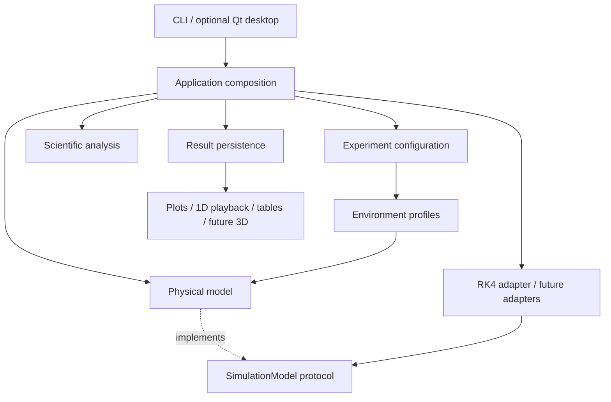

# Architecture

Use a single-process modular Python application. Keep physical and numerical
code headless; the optional desktop shell invokes the same application workflow
as the CLI. Start with concrete implementations and two small protocols,
without a dependency-injection framework, event bus, or service layer.

## Module responsibilities

| Module | Responsibility and boundary | Current implementation |
| --- | --- | --- |
| Application Core | Compose configuration, model, adapter, analysis, persistence; expose use cases to CLI/Qt | `application.py`, `__main__.py` |
| Environment Management | Versioned ambient profiles independent of simulation bodies | `environments.py`, JSON schema, LAND/MARINE/AIR examples |
| Mathematical Modeling | Declare state, units, parameters, equations, assumptions, RHS | `modeling.py`, `models/constant_acceleration.py` |
| Simulation Engine Adapters | Advance supported models; isolate solver/engine APIs | `engines/base.py`, `engines/rk4.py` |
| Experiment Management | Validate immutable run inputs; preserve full inputs, history, provenance | `experiments/config.py`, `experiments/results.py` |
| Scientific Data Analysis | Compare states with independent references and declared tolerances | `analysis.py` |
| Visualization | Consume results/state snapshots; never own or mutate physical truth | `desktop/charts.py`: CPU-painted plots and 1D playback |
| Learning and Documentation | Explain equations, assumptions, errors, interpretation, scientific findings | `docs/`, metadata, in-app model and validation notes |
| Future Plugin Support | Versioned model/adapter/environment/analysis providers | Extension policy documented; discovery/loading deferred |

## Dependency and data flow

Configuration and result types are shared data contracts, not workflow
services. Numerical adapters may import `SolverConfig` but never application
or persistence logic. Physical models import mathematical contracts and
environment data, not experiment orchestration, engines, or GUI packages.
The composition root knows the single supported concrete model and adapter;
adding a second validated implementation is the point to introduce a small
explicit factory map. Unknown model/adapter versions fail without fallback.

The workflow is: read strict JSON → validate/normalize → resolve ambient
inputs into a model → integrate → validate against the analytical reference
→ assemble provenance → save a new result file. A failed run is not published
as a successful result. This reference workflow's analytical gate is specific
to constant acceleration, not a universal requirement for every future model.

## Environments and physical meaning

Profiles declare uniform conditions in a right-handed inertial world frame,
with z upward. Gravity and currents/wind are world-frame vectors. Land terrain
is a reference horizontal plane height, not a collision engine. Friction is a
nonnegative dimensionless scalar; there is no universal upper bound of one.
Fluid density and absolute temperature must be positive.

The open `category` identifier permits additional profiles without changing
the envelope or engine interface. Known categories have exact property sets;
new categories accept finite scalar properties. An extension provider will
need its own documented schema, units, ranges, and validation before its
properties acquire simulation semantics. Storage support alone is not
validated physical support. Field evaluators for spatial/time variation
should be introduced only when required by an actual model.

The Phase 0 model projects gravity onto its selected axis and adds a prescribed
constant acceleration. It declares that it ignores all other ambient data.
The land profile's nonzero friction coefficient does not create a friction
force without contact. Changing the environment does not alter the model's
equations. Rendering never affects integration or collision behavior.

## Reproducibility and resources

Inputs use SI units in explicit field names, versioned schemas, and ordered
state metadata. A result contains the resolved configuration, model description,
effective acceleration, all samples including t=0, numerical settings,
validation report, Python/platform versions, and SHA-256 fingerprints of
normalized inputs and installed package source/schemas. There is no randomness
or wall-clock input. Same code, inputs, and runtime produce identical JSON
on this tested host. Floating-point results across platforms should be compared
with scientific tolerances, not assumed bitwise identical.

Fingerprints identify code; they do not archive it. Preserve the matching source
revision/package alongside important experiment records. No repository commit
existed during inspection; source hashing also identifies uncommitted edits.
Future stochastic engines must record RNG algorithm, seed, engine build,
dependency versions, and nondeterminism limitations explicitly.

The core holds at most 100,001 samples in memory and writes a single human-readable
JSON file. The optional desktop runs it in one QThread and paints views on the
CPU. This bound is a guardrail for
the small proof, not a throughput promise for future large state vectors.
Introduce chunked storage/streaming and worker cancellation when larger
experiments require them. Saving refuses overwrites but is not
crash-atomic; interrupted writes can leave an incomplete file.

## Desktop MVP (0.2.0)

The user's follow-up authorized a usable desktop MVP after Phase 0. The
`desktop` package owns Qt widgets, profile presets, plots, playback, and file
dialogs. It calls `run_experiment` with a validated immutable snapshot on one
worker thread, then displays the returned result. Workers signal success or
failure back to the main thread; only the main thread updates widgets.

Inputs are frozen in the UI during a run. Closing during a run is deferred
until it finishes; cancellation is not implemented. The 100,000-step limit
still applies. QThread keeps event processing separate but is not a claim
of parallel Python numerical acceleration.

Edits mark the displayed result as stale instead of mutating it. Exports
always use that result's original inputs. Playback and cursor scrubbing only
select recorded samples; wall-clock playback speed cannot change numerical
results. Large histories use a virtual table and at most roughly 2,400 plotted
vertices per curve; the saved data and analytical checks retain every sample.

The desktop dependency is optional (`desktop` extra), and the existing CLI
still runs with site packages disabled. No Matplotlib, GPU, web server, OS
integration installation, or external simulation engine was added.

## Extension toward coupled multiphysics

An explicit ODE protocol is sufficient here; it does not pretend to represent
DAEs, PDEs, contact constraints, or arbitrary external engine worlds. Adapters
must declare supported problem classes before such models are accepted.
Use a composed state vector and combined RHS first when two validated
subsystems can share one solver. Specify exchanged quantities, SI units,
frames, sign conventions, and conservation balances.

For genuinely separate engines, add explicit coupling ports and a scheduler
only after defining communication steps, interpolation, algebraic-loop handling,
and energy/mass/charge transfer checks. Validate coupling convergence and
conservation separately from each solver's correctness. Do not silently
replace a coupled problem with uncoupled or lagged approximations.

External ROS/Gazebo, ngspice, Octave, or CAD integrations belong in optional
adapters. Some will require subprocess isolation for interpreter/ABI or
lifecycle reasons; this is an adapter implementation choice, not a microservice
architecture. Existing installations and unrelated workspaces remain untouched.
